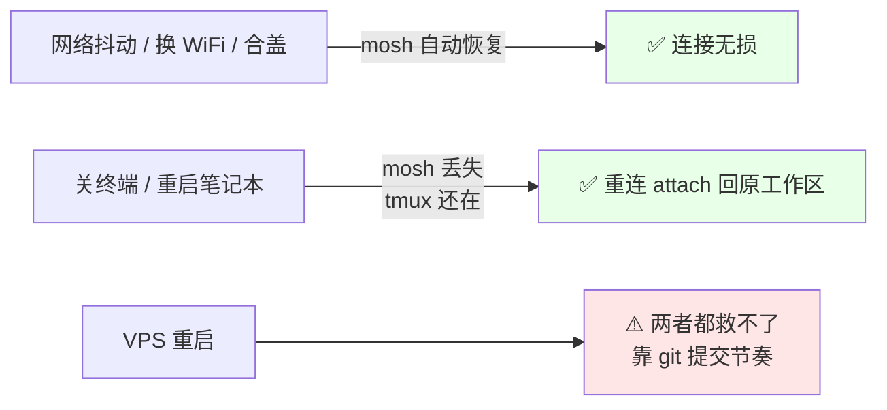

## 背景

正常情况下直接使用操作系统自带的终端工具 SSH 登录 debian 服务器就可以了。

但是，在网络缓慢并且不稳定的情况下，典型如我从国内 SSH 登录到美国尤其是美国东部的服务器上，执行 codex 等需要长时间运行的命令时，就容易出现断连等问题。

### 裸ssh的问题

总结来说，裸 SSH 在这种网络不佳（ping值在250到300之间）的情况下主要有三个问题：

| 问题           | 原因                                          | 在 240ms 链路上的表现              |
| -------------- | --------------------------------------------- | ---------------------------------- |
| **打字有延迟** | 每个字符都要等服务端回显                      | 敲一个字母等 200-300ms 才出现      |
| **丢包就卡死** | TCP 拥塞控制：丢一个包，窗口回退并等待重传    | 8% 丢包时，屏幕静止十几秒          |
| **换网必断线** | TCP 用四元组（源IP:端口↔目标IP:端口）标识连接 | WiFi 切 5G、代理换节点，连接必然断 |

### mosh 的用途

| 机制                    | 作用                                                         |
| ----------------------- | ------------------------------------------------------------ |
| **本地回显（预测）**    | 按键立即在本地绘制，不等服务端确认 → 200-300ms 延迟基本可忽略 |
| **状态同步协议（SSP）** | 传输“屏幕状态差异”，不传字符流 → 丢包只是少刷一帧，不阻塞后续 |
| **会话漫游**            | 用 128 位会话密钥标识会话，不用 IP → 换网继续传              |

关键原理：mosh 登录时，SSH 只活 1数秒——完成“认证 + 传 UDP 端口 + 传密钥 + 起服务”后立刻退出，之后全程 UDP + AES-128-OCB 加密。另外：mosh 的安全性不比 SSH 弱。

和SSH 相比，mosh 做不到的事情：

| 能力                 | 支持 | 替代                        |
| -------------------- | ---- | --------------------------- |
| **TCP 端口转发**     | ❌    | `ssh -fN vps-tunnel` 单独开 |
| scp / sftp / SSHFS   | ❌    | `rsync -e ssh`              |
| X11 / ssh-agent 转发 | ❌    | —                           |

因此，日常的分工就是一般用 mosh 长时间连接和工作，遇到上面这几个 mosh 搞不定的事情，再换普通 SSH 临时顶一下。

### tmux 的用途

SSH 或者 mosh 客户端进程一死，会话就找不回来了（密钥只在客户端内存里）：

| 场景                               | 裸 SSH | mosh       | tmux                    |
| ---------------------------------- | ------ | ---------- | ----------------------- |
| 网络抖动、换网、合盖               | ❌ 断连 | ✅ 自动恢复 | —                       |
| **关终端、重启笔记本、笔记本崩溃** | ❌ 丢失 | ❌ 丢失     | ✅ 会话还在，attach 回来 |
| VPS 重启                           | ❌ 丢失 | ❌ 丢失     | ❌ 丢失                  |

所以，每次 `mosh` 都应该创建全新会话，不重连旧的。 mosh 和 tmux 必须一起用。

### 组合方案

采用 mosh + tmux 组合来解决裸 ssh 的问题：

- mosh 保障“连接不断”
- tmux 保障“工作不丢”

mosh 和 tmux 分工如下：



养成使用习惯：**所有 agent 都跑在 tmux 里，不要在裸 shell 里跑。**

```bash
# ✅
tmux new -A -s codex
codex

# ❌ mosh 进程一死，agent 也跟着死
codex
```

mosh 保连接，tmux 保工作区——两个都到位，我们才敢可以放心合盖、换网、断线。

## 安装和配置

### 服务器端

安装 mosh 和 tmux：

```bash
sudo apt install -y mosh tmux

# ⚠️ 最容易漏的一步：UTF-8 locale（缺了会报 "needs a UTF-8 native locale"）
locale | grep -i utf-8
# 无输出就执行：
sudo sed -i 's/^# *en_US.UTF-8 UTF-8/en_US.UTF-8 UTF-8/' /etc/locale.gen
sudo locale-gen && sudo update-locale LANG=en_US.UTF-8
```

配置防火墙：

| 层次                           | 规则                                                     |
| ------------------------------ | -------------------------------------------------------- |
| 控制台（如腾讯云，Hostinger ） | `accept / UDP / 60000:61000`（**冒号**，协议必须选 UDP） |
| 操作系统（如ufw）              | `sudo ufw allow 60000:61000/udp`（会自动镜像到 v6）      |

验证：

```bash
sudo ufw status verbose | grep 60000
ss -ulnp | grep mosh      # 平时为空是正常的，说明没会话
```

配置 `~/.tmux.conf`：

```bash
cat > ~/.tmux.conf <<'EOF'
# ── 基础 ──
set -g mouse on
set -g history-limit 50000          # agent 输出动辄几千行，默认 2000 不够
set -g base-index 1
setw -g pane-base-index 1
set -g focus-events on

# ── 终端类型（mosh 环境下兼容性最好）──
set -g default-terminal "screen-256color"
set -ga terminal-overrides ",*256col*:Tc"

# ── 剪贴板（配 OSC 52，终端选中可直接进系统剪贴板）──
set -g set-clipboard on

# ── 状态栏 ──
set -g status-interval 5
set -g status-right '%H:%M | #H'
set -g status-left '[#S] '

# ── 分屏继承当前目录 ──
bind | split-window -h -c "#{pane_current_path}"
bind - split-window -v -c "#{pane_current_path}"

# ── 重载 ──
bind r source-file ~/.tmux.conf \; display "已重载"
EOF
```

### 客户端

安装 mosh：

```bash
sudo apt install -y mosh
```

修改 `~/.ssh/config`：

```bash
Host skyvps
    HostName 2.25.115.31
    User sky
    IdentityFile ~/.ssh/id_rsa
    #IdentityFile ~/.ssh/id_ed25519
    ServerAliveInterval 20
    ServerAliveCountMax 3
    TCPKeepAlive yes
    Compression no              # 让 mosh/SSH 自己管，压缩反而增加 CPU
    ControlMaster auto          # 复用连接，多个窗口秒开
    ControlPath ~/.ssh/cm-%r@%h:%p
    ControlPersist 10m

Host skyvps6
    HostName 2a02:4780:95:c069::1
    User sky
    IdentityFile ~/.ssh/id_rsa
    AddressFamily inet6
    ServerAliveInterval 20
    ServerAliveCountMax 3
    TCPKeepAlive yes

Host skyvps-tunnel
    HostName 2.25.115.31
    User sky
    IdentityFile ~/.ssh/id_rsa
    ControlMaster no          # 必须独立，否则复用主连接不会建立转发
    ControlPath none
    LocalForward 8080 127.0.0.1:8080
    TCPKeepAlive yes
```

### 绕开代理（感觉没必要）

客户端如果启用了代理，如Clash Verge ，则需要添加规则（**放最前面**）。在 clash verge 左边的 Profiles（配置）页 → 右侧栏 → 「全局扩展配置」/ Global Merge → edit file，增加以下内容：

```bash
rules:
  - IP-CIDR,2.25.115.31/32,DIRECT
  - IP-CIDR6,2a02:4780:95:c069::/48,DIRECT
```

点"Reactive profiles" 后验证：

```bash
# 验证：两条都不能出现 Meta / utun / tun
ip route get 2.25.115.31
ip -6 route get 2a02:4780:95:c069::1
```

这是开启了 clash verge 的检测结果：

```bash
$ ip route get 2.25.115.31
2.25.115.31 via 198.18.0.2 dev Mihomo table 2022 src 198.18.0.1 uid 1000 
    cache 

$ ip -6 route get 2a02:4780:95:c069::1
2a02:4780:95:c069::1 from :: via fe80::28d5:aaff:feb6:c59b dev wlp0s20f3 proto ra src 240e:46e:b810:1adc:13e0:b9ce:5889:1013 metric 20600 pref medium
```

备注：先不绕开试试，走代理应该比直连快才是。

## 使用

最常用的命令：

```bash
# 主力：进常驻会话（存在则 attach，不存在则新建）
mosh skyvps tmux new -A -s codex

# 应急：v4 被代理掐断时走 v6
mosh --family=inet6 skyvps6 tmux new -A -s codex

# code-server 隧道（mosh 不转发端口，必须用 ssh）
ssh -fN skyvps-tunnel && xdg-open http://localhost:8080
```

最常用的几条 tmux 命令：

| 快捷键                 | 场景                            |
| ---------------------- | ------------------------------- |
| **`Ctrl-b` `d`**       | 脱离会话，让它继续跑            |
| **`Ctrl-b` `z`**       | 窗格全屏 / 还原（看长日志必备） |
| **`Ctrl-b` `           | `** / **`-`**                   |
| **`Ctrl-b` `[`** → `y` | 复制到系统剪贴板                |
| **`Ctrl-b` `r`**       | 重载配置                        |

## 附录：tmux 命令速查

前面的 tmux.conf 里设置了 `base-index 1` 和 `pane-base-index 1`，因此窗口和窗格都从 **1** 开始编号。前缀键默认为 `Ctrl-b`。

### 会话控制（session）

| 命令                         | 作用                                          |
| ---------------------------- | --------------------------------------------- |
| `tmux`                       | 新建一个匿名会话                              |
| `tmux new -s codex`          | 新建命名会话                                  |
| **`tmux new -A -s codex`**   | ⭐ **存在则 attach，不存在则新建**（日常主力） |
| `tmux ls`                    | 列出所有会话                                  |
| `tmux attach -t codex`       | 连接到会话                                    |
| `tmux a -t codex`            | 同上，简写                                    |
| `tmux kill-session -t codex` | 删除会话                                      |
| `tmux kill-server`           | 关掉全部会话（**慎用**）                      |

会话内操作：

| 快捷键             | 作用                                 |
| ------------------ | ------------------------------------ |
| `Ctrl-b` `d`       | **detach**（脱离，会话继续在后台跑） |
| `Ctrl-b` `s`       | 列出并切换会话                       |
| `Ctrl-b` `)` / `(` | 下一个 / 上一个会话                  |
| `Ctrl-b` `$`       | 重命名会话                           |
| `Ctrl-b` `:`       | 命令模式                             |

⚠️ **在 tmux 里不要再执行 `tmux attach`**，否则会报 `sessions should be nested with care`。切换会话时，请使用 `Ctrl-b s`，或：

```bash
tmux switch-client -t other-session
```

### 窗口操作（window）

| 快捷键             | 作用                             |
| ------------------ | -------------------------------- |
| `Ctrl-b` `c`       | 新建窗口（继承当前目录）         |
| `Ctrl-b` `1`–`9`   | 跳到第 N 个窗口                  |
| `Ctrl-b` `n` / `p` | 下一个 / 上一个窗口              |
| `Ctrl-b` `l`       | 回到上一个窗口                   |
| `Ctrl-b` `w`       | **列出所有窗口**（带预览，好用） |
| `Ctrl-b` `,`       | 重命名当前窗口                   |
| `Ctrl-b` `&`       | 关闭当前窗口（会确认）           |
| `Ctrl-b` `.`       | 修改窗口编号                     |
| `Ctrl-b` `f`       | 按名字搜索窗口                   |

## 窗格操作（Pane）

**创建**（注意：你用自定义的 `|` 和 `-`，比默认的 `%`/`"` 好按）：

| 快捷键           | 作用                     |
| ---------------- | ------------------------ |
| **`Ctrl-b` `     | `**                      |
| **`Ctrl-b` `-`** | 上下分屏（横切）         |
| `Ctrl-b` `%`     | 左右分屏（默认键，等效） |
| `Ctrl-b` `"`     | 上下分屏（默认键，等效） |
| `Ctrl-b` `!`     | 把当前窗格拆成独立窗口   |

**移动与调整：**

| 快捷键                 | 作用                                      |
| ---------------------- | ----------------------------------------- |
| `Ctrl-b` `方向键`      | 切换到相邻窗格                            |
| `Ctrl-b` `o`           | 按顺序循环切换                            |
| `Ctrl-b` `q`           | 显示窗格编号（按数字直接跳）              |
| **`Ctrl-b` `z`**       | ⭐ **当前窗格全屏 / 还原**（看长输出必备） |
| `Ctrl-b` `{` / `}`     | 窗格左右交换位置                          |
| `Ctrl-b` `空格`        | 循环切换布局                              |
| `Ctrl-b` `Ctrl-方向键` | 调整窗格大小（每次 1 格）                 |
| `Ctrl-b` `Alt-方向键`  | 调整窗格大小（每次 5 格）                 |
| `Ctrl-b` `x`           | 关闭当前窗格（会确认）                    |
| `Ctrl-b` `;`           | 跳到上一个活动窗格                        |

### 滚动与复制（copy mode）

配置开启了 `mouse on`，所以**直接用滚轮就能翻历史**，这是最常用的方式。

键盘操作：

| 快捷键              | 作用                                                         |
| ------------------- | ------------------------------------------------------------ |
| `Ctrl-b` `[`        | 进入 copy mode                                               |
| `PgUp` / `PgDn`     | 翻页（有鼠标时也直接可用）                                   |
| `方向键` / `hjkl`   | 移动光标                                                     |
| `Ctrl-u` / `Ctrl-d` | 半页上下                                                     |
| `g` / `G`           | 跳到最顶 / 最底                                              |
| `/` 然后输入        | 向下搜索                                                     |
| `?` 然后输入        | 向上搜索                                                     |
| `n` / `N`           | 下一个 / 上一个匹配                                          |
| `空格`              | 开始选择                                                     |
| `Enter`             | 复制选中内容                                                 |
| **`y`**             | ⭐ **复制并退出**（配置了 `set-clipboard on`，可直接进系统剪贴板） |
| `q` / `Esc`         | 退出 copy mode                                               |

**从 VPS 复制到本地**：`Ctrl-b [` → 选中 → `y` → 本地 `Ctrl+V`。这依赖终端支持 OSC 52（GNOME Terminal、Konsole、Kitty 都支持）。
